# Arquitetura do Sistema SEC MAIS

> **Secretaria da Educação do Estado da Bahia (SEC-BA)**  
> **Trabalho de Conclusão de Curso (TCC) — Engenharia de Dados**  
> Documento de Arquitetura Técnica e Decisões de Engenharia

---

## 1. Visão Geral da Arquitetura

O **SEC MAIS** é uma plataforma de engenharia de dados projetada para unificar, higienizar, modelar e disponibilizar analiticamente os dados de programas de políticas públicas educacionais do Estado da Bahia: **Bolsa Presença**, **Pé-de-Meia** e **Universidade Para Todos (UPT)**.

A plataforma combina o padrão de **Arquitetura Medalhão** (Data Lake em camadas Bronze, Prata e Ouro) com a modelagem dimensional **Star Schema de Ralph Kimball** e uma **Camada Marts** disponibilizada em um **Data Warehouse Relacional Analítico (PostgreSQL em container Docker)** com **dupla persistência** (arquivos Apache Parquet e tabelas SQL relacionais).

---

## 2. Diagrama da Arquitetura de Dados

```mermaid
flowchart TD
    subgraph FONTES["1. Fontes Transacionais Corporativas (Rede SEC-BA via VPN)"]
        O1["Oracle SIADIANTE<br/>Bolsa Presença<br/>Porta 1521"]
        P1["PostgreSQL SIGEDUC<br/>Pé-de-Meia<br/>Porta 5432"]
        P2["PostgreSQL UPT<br/>Universidade Para Todos<br/>Porta 5435"]
    end

    subgraph EXTRACAO["2. Camada de Ingestão e Conectividade"]
        EXT["Scripts Python + SQLAlchemy<br/>(Execução no Host com VPN ativa)"]
    end

    subgraph MEDALHAO["3. Data Lake Medalhão Local (Apache Parquet)"]
        subgraph BRONZE["Camada Bronze (Raw Ingestion)"]
            B1["armazenamento/bronze/<br/>Particionamento diário: ano/mes/dia<br/>Dados brutos imutáveis"]
        end
        subgraph PRATA["Camada Prata (Cleaned & Curated)"]
            P_DATA["armazenamento/prata/<br/>Higienização: CPF, Matrícula, Nomes<br/>Deduplicação por Chave de Negócio<br/>Particionamento mensal: ano/mes"]
        end
        subgraph OURO_LAKE["Camada Ouro (Dimensional Star Schema)"]
            O_DATA["armazenamento/ouro/<br/>fato_beneficio_estudante.parquet<br/>dim_estudante.parquet<br/>dim_programa.parquet<br/>dim_tempo.parquet<br/>dim_municipio.parquet"]
        end
    end

    subgraph DW["4. Data Warehouse Analítico (PostgreSQL 16 Docker)"]
        subgraph SCHEMA_OURO["Schema: ouro"]
            DW_FATO["ouro.fato_beneficio_estudante"]
            DW_EST["ouro.dim_estudante"]
            DW_PROG["ouro.dim_programa"]
            DW_TEMP["ouro.dim_tempo"]
            DW_MUN["ouro.dim_municipio"]
        end
        subgraph SCHEMA_MARTS["Schema: marts (Analytical Views)"]
            V1["vw_participacao_programas"]
            V2["vw_sobreposicao_matriculas"]
            V3["vw_resumo_sobreposicao"]
            V4["vw_analise_financeira_bolsa_presenca"]
            V5["vw_cobertura_relacionamento_fontes"]
            V6["vw_indicadores_executivos_sprint3"]
        end
    end

    subgraph CONSUMO["5. Consumo e Visualização Analítica"]
        NOTEBOOKS["Jupyter Notebooks (Evidências Sprints 2 e 3)"]
        BI["Ferramentas BI / Consultas SQL / Relatórios TCC"]
    end

    FONTES --> EXTRACAO
    EXTRACAO --> BRONZE
    BRONZE --> PRATA
    PRATA --> OURO_LAKE
    OURO_LAKE --> SCHEMA_OURO
    SCHEMA_OURO --> SCHEMA_MARTS
    SCHEMA_MARTS --> CONSUMO
```

---

## 3. As Camadas do Data Lake Medalhão

### 3.1 Camada Bronze (Raw Ingestion)
* **Localização:** `armazenamento/bronze/<programa>/ano=YYYY/mes=MM/dia=DD/`
* **Formato:** Apache Parquet com compressão Snappy.
* **Propósito:** Preservação estrita dos dados brutos tal como extraídos das fontes operacionais da SEC-BA, sem qualquer modificação ou transformação estrutural.
* **Características:**
  * Histórico imutável (*append-only*).
  * Metadados de rastreabilidade: `_data_extracao`, `_programa`.
  * Preservação de erros, valores nulos e representações de origem para fins de auditoria e conformidade técnica.

### 3.2 Camada Prata (Cleaned & Curated)
* **Localização:** `armazenamento/prata/<programa>/ano=YYYY/mes=MM/`
* **Formato:** Apache Parquet com compressão Snappy.
* **Propósito:** Dados higienizados, tipados e deduplicados por chave de negócio.
* **Regras de Tratamento:**
  * **Matrícula:** Filtragem estrita de caracteres não numéricos (`\D`) e anulação de campos vazios (`NULL`).
  * **CPF:** Higienização de pontuação, aplicação de preenchimento `LPAD 11` (zeros à esquerda) e validação de comprimento.
  * **Nomes:** Conversão padronizada para caixa alta (`UPPER`) e remoção de múltiplos espaços em branco intermediários.
  * **Deduplicação:**
    * *Bolsa Presença:* Chave composta `(MATRICULA, ANO, MES)`.
    * *Pé-de-Meia:* Chave composta `(MATRICULA, ANO)`.
    * *UPT:* Chave `(NUMERO_INSCRICAO)`.

### 3.3 Camada Ouro (Dimensional Star Schema)
* **Localização:** `armazenamento/ouro/`
* **Formato:** Apache Parquet com compressão Snappy.
* **Propósito:** Dados estruturados no modelo dimensional de Ralph Kimball.
* **Estrutura:**
  * `fato_beneficio_estudante.parquet` (Grão: 1 linha por Estudante × Programa × Período).
  * `dim_estudante.parquet` (Surrogate Key, CPF mascarado sob LGPD).
  * `dim_programa.parquet` (Catálogo, órgãos gestores e regras de interpretação).
  * `dim_tempo.parquet` (Tratamento para calendários mensais e anuais).
  * `dim_municipio.parquet` (Localidades do Estado da Bahia).

---

## 4. O Data Warehouse Analítico (PostgreSQL em Docker)

Para viabilizar consultas SQL de alta performance, cruzamentos relacionais e servir a camada semântica com visões agregadas, o projeto implementa um **Data Warehouse em container Docker**:

* **Engine:** PostgreSQL 16 Alpine (`sec_mais_postgres_dw`).
* **Porta:** `5432` no host local.
* **Banco:** `sec_mais_dw`.
* **Schemas:**
  * **`ouro`:** Contém as 5 tabelas físicas do Star Schema, carregadas pelo orquestrador e indexadas nas chaves primárias e estrangeiras.
  * **`marts`:** Contém as visões analíticas (`views_marts.sql`) prontas para consumo por ferramentas de BI, analistas e gestores educacionais.

---

## 5. Decisões de Engenharia e Justificativas Técnicas

### 5.1 Por que a extração roda no Host Windows e não em Docker?
* **Causa:** As bases de dados corporativas da SEC-BA (Oracle SIADIANTE e PostgreSQL UPT/SIGEDUC) são protegidas e acessíveis **exclusivamente via VPN corporativa**.
* **Impacto no Docker/WSL2:** No Windows, interfaces de rede de contêineres Docker e subsistemas WSL2 criam comutadores virtuais (*vEthernet*) que não herdam automaticamente as rotas nem resolvem os nomes DNS corporativos da VPN estadual instalada no host.
* **Solução:** A extração foi projetada para rodar via Python nativo no ambiente virtual do host Windows, garantindo acesso pleno e transparente ao túnel VPN.

### 5.2 Por que o PostgreSQL DW roda em Docker?
* O DW local não depende da VPN da SEC-BA (ele recebe os dados já extraídos e higienizados).
* O Docker fornece isolamento completo, reprodutibilidade imediata em qualquer máquina via `docker-compose up -d`, sem necessidade de instalar ou configurar serviços de banco de dados pesados no Windows do usuário.

### 5.3 Por que Dupla Persistência (Parquet + PostgreSQL)?
* **Arquivos Parquet:** Garantem a portabilidade do Data Lake, backup imutável, facilidade de compartilhamento acadêmico e leitura colunar ultra-rápida via Pandas/PyArrow.
* **PostgreSQL DW:** Oferece capacidade relacional completa (índices B-Tree, constraints, chaves estrangeiras, visões SQL complexas e conectividade direta com ferramentas de BI como Power BI, Metabase e DBeaver).

### 5.4 Por que Pandas e PyArrow em vez de PySpark local?
* **Viabilidade Técnica:** Executar Apache Spark localmente em ambiente Windows corporativo impõe dependências complexas de Java (`JAVA_HOME`), binários `winutils.exe` do Hadoop e alto consumo de memória RAM.
* **Performance:** Para o volume de dados do projeto (amostragens controladas de até 600.000 registros por carga mensal), a combinação **Pandas + PyArrow** executa a higienização e modelagem dimensional em segundos, com menor consumo de recursos e zero fricção de configuração.

### 5.5 Por que um Orquestrador Python Nativo (`pipeline_runner.py`)?
* **Incompatibilidade do Airflow no Windows:** O Apache Airflow não possui suporte nativo ao Windows (depende de chamadas POSIX e compilação C++ durante a instalação de pacotes).
* **Solução:** O `pipeline_runner.py` fornece uma interface modular CLI (`--etapa prata`, `--etapa ouro`, `--etapa dw`, `--etapa testes`), com logs detalhados via Loguru, controle de falhas e compatibilidade total com o Agendador de Tarefas do Windows (Task Scheduler).

---

## 6. Governança e Conformidade com a LGPD

1. **Anonimização de Chaves:** A chave do estudante (`id_estudante`) é uma *Surrogate Key* gerada via Hash criptográfico dos identificadores naturais, impedindo o rastreamento direto de cidadãos nas consultas dimensionais.
2. **Mascaramento de Dados Pessoais:** O CPF do estudante é mascarado no formato `***.456.789-**` na dimensão `dim_estudante`.
3. **Segregação de Credenciais:** As senhas e endpoints das fontes transacionais são gerenciados estritamente via arquivo `.env` (ignorado no Git) e validados em tempo de execução com `pydantic-settings`.
