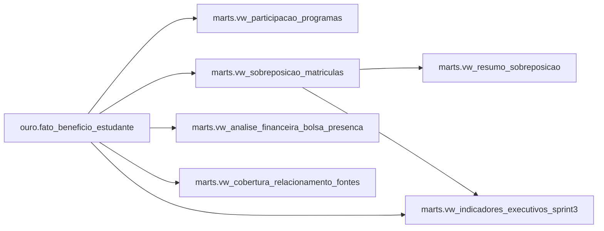

# Camada Marts — Catálogo de Visões Analíticas e Consultas SQL

> **Secretaria da Educação do Estado da Bahia (SEC-BA)**  
> **Trabalho de Conclusão de Curso (TCC) — Engenharia de Dados**  
> Documento de Especificação da Camada de Consumo Analítico (Schema `marts`)

---

## 1. Visão Geral da Camada Marts

A **Camada Marts** representa o topo da arquitetura analítica do **SEC MAIS**, operando dentro do Data Warehouse PostgreSQL (`sec_mais_dw` em Docker). 

Essa camada abstrai a complexidade do *Star Schema* físico da Camada Ouro e disponibiliza **6 visões analíticas de alto nível** (*analytical views*), otimizadas para atender diretamente aos objetivos de pesquisa do TCC, dashboards executivos e relatórios de auditoria educacional.

---

## 2. Catálogo Detalhado das Visões Analíticas



---

### 2.1 `marts.vw_participacao_programas`
* **Finalidade (Sprint 3 — Atividade 1):** Prover uma visão consolidada e comparativa da adesão e participação dos estudantes em cada uma das políticas públicas, agregando por programa, órgão gestor, ano de referência, período e situação cadastral padronizada.
* **Granularidade:** 1 linha por Programa × Órgão Gestor × Ano × Período × Status.

#### Dicionário de Colunas:
| Coluna | Tipo | Descrição |
|---|---|---|
| `nome_programa` | `VARCHAR` | Nome do programa (Bolsa Presença, Pé-de-Meia, Universidade Para Todos). |
| `orgao_gestor` | `VARCHAR` | Órgão responsável (SEC-BA ou MEC / SEC-BA). |
| `ano` | `INTEGER` | Ano de referência. |
| `periodo_referencia` | `VARCHAR` | Nome do mês por extenso ou `'Referência Anual'`. |
| `status` | `VARCHAR` | Status canônico (`ATIVO`, `INSCRITO`, `INATIVO`). |
| `total_estudantes_participantes` | `BIGINT` | Quantidade de estudantes distintos vinculados àquela combinação. |
| `possui_valor_financeiro` | `BOOLEAN` | Indica se o programa envolve repasse de valores na fonte. |
| `regras_interpretacao` | `TEXT` | Nota metodológica sobre as regras do programa. |

---

### 2.2 `marts.vw_sobreposicao_matriculas`
* **Finalidade (Sprint 3 — Atividade 2):** Identificar a sobreposição de políticas discentes por estudante, mapeando individualmente quais e quantos programas cada estudante acumula simultaneamente.
* **Granularidade:** 1 linha por Estudante / Matrícula.

#### Dicionário de Colunas:
| Coluna | Tipo | Descrição |
|---|---|---|
| `id_estudante` | `VARCHAR` | Surrogate Key anônima do discente. |
| `matricula_conciliacao` | `VARCHAR` | Matrícula escolar formatada ou `'SEM MATRÍCULA REGISTRADA'`. |
| `nome_estudante` | `VARCHAR` | Nome do estudante em caixa alta. |
| `cpf_mascarado` | `VARCHAR` | CPF protegido no padrão `***.456.789-**`. |
| `qtd_programas_associados` | `BIGINT` | Quantidade de programas distintos em que o estudante aparece (1, 2 ou 3). |
| `combinacao_programas` | `TEXT` | Lista descritiva dos programas acumulados (ex: `Bolsa Presença + Pé-de-Meia`). |
| `recebe_bolsa_presenca` | `BOOLEAN` | Flag indicando se participa do Bolsa Presença. |
| `recebe_pe_de_meia` | `BOOLEAN` | Flag indicando se participa do Pé-de-Meia. |
| `recebe_upt` | `BOOLEAN` | Flag indicando se participa do Universidade Para Todos. |
| `classificacao_atendimento` | `VARCHAR` | `'SOBREPOSIÇÃO MULTI-PROGRAMA'` (≥ 2 apoios) ou `'PROGRAMA ÚNICO'`. |

---

### 2.3 `marts.vw_resumo_sobreposicao`
* **Finalidade (Sprint 3 — Atividade 2 Resumo):** Apresentar a distribuição percentual consolidada dos estudantes entre as diversas combinações de políticas públicas, facilitando a elaboração de gráficos de pizza ou barras para o relatório do TCC.
* **Granularidade:** 1 linha por Nível de Sobreposição × Combinação de Programas.

#### Dicionário de Colunas:
| Coluna | Tipo | Descrição |
|---|---|---|
| `qtd_programas_associados` | `BIGINT` | Nível de acumulação de apoios (1, 2 ou 3). |
| `combinacao_programas` | `TEXT` | Nome da combinação de benefícios. |
| `total_estudantes` | `BIGINT` | Quantidade total de estudantes nesta categoria. |
| `percentual_representatividade` | `NUMERIC(5,2)` | Percentual em relação ao universo total de estudantes atendidos. |

---

### 2.4 `marts.vw_analise_financeira_bolsa_presenca`
* **Finalidade (Sprint 3 — Atividade 3):** Consolidar os valores financeiros individualizados confiáveis do Bolsa Presença, calculando o montante total, ticket médio, valor mínimo e máximo por município e competência temporal.
* **Granularidade:** 1 linha por Município × Ano × Mês.

#### Dicionário de Colunas:
| Coluna | Tipo | Descrição |
|---|---|---|
| `municipio` | `VARCHAR` | Nome oficial do município baiano. |
| `ano` | `INTEGER` | Ano civil da folha. |
| `mes` | `INTEGER` | Mês de competência da folha de pagamento. |
| `total_beneficiarios_com_valor` | `BIGINT` | Total de estudantes com valores válidos liquidados no SIADIANTE. |
| `valor_medio_registrado` | `NUMERIC(10,2)` | Valor médio do benefício por estudante (ticket médio no município). |
| `valor_minimo` | `NUMERIC(10,2)` | Menor valor individual pago na competência. |
| `valor_maximo` | `NUMERIC(10,2)` | Maior valor individual pago (ex: famílias com múltiplos estudantes). |
| `total_recursos_registrados_siadiante` | `NUMERIC(14,2)` | Montante financeiro total alocado no município. |
| `nota_metodologica` | `TEXT` | Declaração metodológica sobre a fonte dos valores. |

---

### 2.5 `marts.vw_cobertura_relacionamento_fontes`
* **Finalidade (Sprint 3 — Atividade 5):** Medir a cobertura, qualidade de preenchimento e integridade dos relacionamentos entre as fontes operacionais, avaliando o percentual de conformidade de matrículas e diagnosticando as causas de dados ausentes.
* **Granularidade:** 1 linha por Origem do Dado × Programa.

#### Dicionário de Colunas:
| Coluna | Tipo | Descrição |
|---|---|---|
| `origem_dado` | `VARCHAR` | Sistema e banco de extração (`SIADIANTE (Oracle)`, `SIGEDUC (Postgres)`, `UPT (Postgres)`). |
| `programa` | `VARCHAR` | Nome do programa. |
| `total_registros_fato` | `BIGINT` | Total de registros na tabela fato. |
| `estudantes_distintos` | `BIGINT` | Total de estudantes distintos atendidos pelo programa. |
| `registros_com_matricula` | `BIGINT` | Registros que possuem matrícula escolar preenchida e válida. |
| `registros_sem_matricula` | `BIGINT` | Registros sem matrícula (nulos ou em branco). |
| `taxa_conformidade_matricula` | `NUMERIC(5,2)` | Percentual de cobertura da matrícula: `(com_matricula / total) * 100`. |
| `diagnostico_causa_ausencia` | `TEXT` | Justificativa técnica (ex: inscrições no UPT abertas a egressos externos da rede que não possuem matrícula escolar ativa). |

---

### 2.6 `marts.vw_indicadores_executivos_sprint3`
* **Finalidade (Sprint 3 — Atividade 10):** Tabela resumo de uma única linha contendo os KPIs fundamentais do TCC para apresentação executiva imediata e painéis gerenciais.

#### Dicionário de Colunas:
| Coluna | Tipo | Descrição |
|---|---|---|
| `total_estudantes_unicos_atendidos` | `BIGINT` | Total de indivíduos distintos cobertos pelas políticas analisadas. |
| `total_concessoes_registradas` | `BIGINT` | Total de registros na tabela fato. |
| `beneficiarios_bolsa_presenca` | `BIGINT` | Total de estudantes no Bolsa Presença. |
| `beneficiarios_pe_de_meia` | `BIGINT` | Total de estudantes no Pé-de-Meia. |
| `inscritos_universidade_para_todos`| `BIGINT` | Total de estudantes no Universidade Para Todos. |
| `total_estudantes_em_multiplos_programas` | `BIGINT` | Quantidade de estudantes que acumulam 2 ou mais programas. |
| `percentual_taxa_sobreposicao` | `NUMERIC(5,2)` | Taxa global de sobreposição de benefícios: `(multiplos / total) * 100`. |
| `montante_financeiro_bolsa_presenca` | `NUMERIC(14,2)` | Volume financeiro total liquidado no Bolsa Presença na competência analisada. |

---

## 3. Exemplos Práticos de Consultas SQL Analíticas

Conectado ao PostgreSQL DW (`host: localhost`, `port: 5432`, `database: sec_mais_dw`, `user: postgres`):

### 3.1 Identificar Estudantes com Sobreposição Tripla
```sql
SELECT
    id_estudante,
    matricula_conciliacao,
    nome_estudante,
    combinacao_programas
FROM marts.vw_sobreposicao_matriculas
WHERE qtd_programas_associados = 3
ORDER BY nome_estudante;
```

### 3.2 Top 10 Municípios com Maior Volume de Recursos no Bolsa Presença
```sql
SELECT
    municipio,
    total_beneficiarios_com_valor,
    valor_medio_registrado,
    total_recursos_registrados_siadiante
FROM marts.vw_analise_financeira_bolsa_presenca
WHERE municipio <> 'NÃO INFORMADO'
ORDER BY total_recursos_registrados_siadiante DESC
LIMIT 10;
```

### 3.3 Distribuição de Situação Cadastral dos Estudantes Ativos por Política
```sql
SELECT
    nome_programa,
    status,
    total_estudantes_participantes
FROM marts.vw_participacao_programas
WHERE status = 'ATIVO'
ORDER BY total_estudantes_participantes DESC;
```
