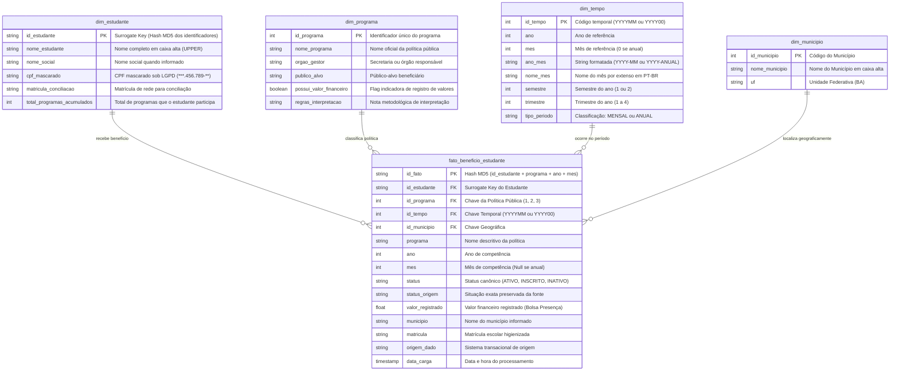

# Documentação Consolidada da Modelagem Dimensional (Star Schema Kimball)

> **Secretaria da Educação do Estado da Bahia (SEC-BA)**  
> **Trabalho de Conclusão de Curso (TCC) — Engenharia de Dados**  
> **Sprint 3 — Atividade 8:** Documentação Consolidada da Arquitetura e Modelagem Dimensional

---

## 1. Introdução e Fundamentação Metodológica

A modelagem dimensional da Camada Ouro do projeto **SEC MAIS** foi construída seguindo rigorosamente os preceitos clássicos da metodologia de **Ralph Kimball** (*The Data Warehouse Toolkit*). 

Em vez de criar tabelas isoladas para cada gráfico ou programa — o que fragmentaria a base e impossibilitaria análises comparativas transversais —, adotou-se um **Star Schema (Esquema em Estrela)** centrado em uma **Tabela Fato Comum**, cercada por dimensões conformes e estáticas. Essa abordagem permite responder com eficiência a perguntas analíticas sobre adesão, sobreposição de benefícios acumulados, distribuição temporal e alocação de recursos educacionais.

---

## 2. Definição do Grão Analítico (Grain)

A definição precisa do grão é a decisão mais crítica na modelagem dimensional:

> **Grão da Tabela Fato (`fato_beneficio_estudante`):**  
> **Exatamente uma linha por Estudante × Programa × Período de Referência.**

### 2.1 Tratamento de Granularidades Mistas entre as Fontes
As fontes de dados da SEC-BA apresentam granularidades temporais distintas:
* **Bolsa Presença (Oracle SIADIANTE):** Granularidade **mensal** (possui mês e ano da folha de pagamento).
* **Pé-de-Meia (PostgreSQL SIGEDUC):** Granularidade **anual** no registro da situação escolar.
* **Universidade Para Todos (PostgreSQL UPT):** Granularidade **anual** referente à edição do processo seletivo do programa preparatório.

Para harmonizar essas origens na mesma base sem perda de integridade:
* Quando a fonte possui mês, utiliza-se a competência mensal respectiva e a chave de tempo `YYYYMM`.
* Quando a fonte não possui mês, o campo `mes` é registrado como `NULL` (ou associado ao código padrão de competência anual `YYYY00` na dimensão tempo), preservando a regra de negócio e permitindo agregações coerentes em relatórios anuais ou mensais.

---

## 3. Diagrama Entidade-Relacionamento Dimensional (Star Schema)



---

## 4. Dicionário de Dados Dimensional (Data Dictionary)

### 4.1 Tabela Fato: `ouro.fato_beneficio_estudante`
Representa as concessões e registros de participação dos estudantes nas políticas públicas da SEC-BA.

| Coluna | Tipo de Dado | Restrição | Descrição e Regras de Negócio |
|---|---|:---:|---|
| `id_fato` | `VARCHAR(32)` | **PK** | Chave substituta da ocorrência gerada por Hash MD5 de `id_estudante + id_programa + ano + mes`. Garante a unicidade no grão. |
| `id_estudante` | `VARCHAR(32)` | **FK** | Referência à `ouro.dim_estudante`. Identificador anônimo do discente. |
| `id_programa` | `INTEGER` | **FK** | Referência à `ouro.dim_programa` (1: Bolsa Presença, 2: Pé-de-Meia, 3: UPT). |
| `id_tempo` | `INTEGER` | **FK** | Referência à `ouro.dim_tempo`. Código `YYYYMM` (mensal) ou `YYYY00` (anual). |
| `id_municipio` | `INTEGER` | **FK** | Referência à `ouro.dim_municipio`. |
| `programa` | `VARCHAR(50)` | Não Nulo | Nome canônico do programa para facilidade de consulta direta. |
| `ano` | `INTEGER` | Não Nulo | Ano civil de referência da política pública. |
| `mes` | `INTEGER` | Opcional | Mês civil da concessão (1 a 12). Nulo para programas anuais. |
| `status` | `VARCHAR(20)` | Não Nulo | Situação padronizada canônica: `ATIVO`, `INSCRITO`, `INATIVO`. |
| `status_origem` | `VARCHAR(100)`| Opcional | Situação cadastral bruta tal como constava na base transacional de origem (preservada para rastreabilidade e auditoria). |
| `valor_registrado`| `NUMERIC(12,2)`| Opcional | Valor nominal registrado no sistema de origem. Confiável para o Bolsa Presença (SIADIANTE). Para Pé-de-Meia e UPT é nulo. |
| `municipio` | `VARCHAR(100)`| Opcional | Município da escola ou da vaga de inscrição. |
| `matricula` | `VARCHAR(30)` | Opcional | Matrícula escolar higienizada para conciliação restrita. |
| `origem_dado` | `VARCHAR(50)` | Não Nulo | Nome do sistema e banco transacional de extração (ex: `SIADIANTE (Oracle)`). |
| `data_carga` | `TIMESTAMP` | Não Nulo | Carimbo de data/hora em que o registro foi inserido no Data Warehouse. |

---

### 4.2 Dimensão Conforme: `ouro.dim_estudante`
Consolida os estudantes únicos identificados através de todas as fontes transacionais.

| Coluna | Tipo de Dado | Restrição | Descrição e Regras de Negócio |
|---|---|:---:|---|
| `id_estudante` | `VARCHAR(32)` | **PK** | Surrogate Key gerada por Hash MD5 da matrícula ou CPF do estudante. |
| `nome_estudante`| `VARCHAR(150)`| Não Nulo | Nome civil completo do estudante padronizado em letras maiúsculas (`UPPER`) com espaços simples. |
| `nome_social` | `VARCHAR(150)`| Opcional | Nome social autodeclarado do discente (quando existente). |
| `cpf_mascarado` | `VARCHAR(14)` | Opcional | Cadastro de Pessoa Física com ofuscação LGPD: `***.XXX.XXX-**`. |
| `matricula_conciliacao`| `VARCHAR(30)` | Opcional | Matrícula formal na rede estadual de ensino para conciliação interna. |
| `total_programas_acumulados`| `INTEGER` | Não Nulo | Quantidade consolidada de políticas distintas em que o estudante está registrado. |

---

### 4.3 Dimensão Estática de Domínio: `ouro.dim_programa`
Catálogo descritivo e normativo das políticas públicas analisadas.

| Coluna | Tipo de Dado | Restrição | Descrição e Regras de Negócio |
|---|---|:---:|---|
| `id_programa` | `INTEGER` | **PK** | Código do programa (1: Bolsa Presença, 2: Pé-de-Meia, 3: UPT). |
| `nome_programa`| `VARCHAR(50)` | Não Nulo | Nome oficial da política pública educacional. |
| `orgao_gestor` | `VARCHAR(100)`| Não Nulo | Órgão governamental responsável pela gestão (ex: SEC-BA, MEC). |
| `publico_alvo` | `VARCHAR(200)`| Não Nulo | Descrição do segmento discente atendido pela política. |
| `possui_valor_financeiro`| `BOOLEAN` | Não Nulo | `TRUE` se a base transacional informa valores de repasse financeiro (`Bolsa Presença`); `FALSE` se informa apenas situação cadastral (`Pé-de-Meia`, `UPT`). |
| `regras_interpretacao`| `TEXT` | Não Nulo | Diretriz de negócio e nota de auditoria para o usuário do relatório analítico. |

---

### 4.4 Dimensão Especializada: `ouro.dim_tempo`
Estrutura temporal que acomoda as duas resoluções do projeto (mensal e anual).

| Coluna | Tipo de Dado | Restrição | Descrição e Regras de Negócio |
|---|---|:---:|---|
| `id_tempo` | `INTEGER` | **PK** | Código numérico formatado como `YYYYMM` (para meses válidos) ou `YYYY00` (para referência anual consolidada). |
| `ano` | `INTEGER` | Não Nulo | Ano civil (ex: 2024, 2025, 2026). |
| `mes` | `INTEGER` | Não Nulo | Mês civil (1 a 12) ou 0 para referência anual. |
| `ano_mes` | `VARCHAR(10)` | Não Nulo | Identificador legível formatado (ex: `2026-11` ou `2026-ANUAL`). |
| `nome_mes` | `VARCHAR(20)` | Não Nulo | Nome por extenso em português (ex: `Novembro`, `Referência Anual`). |
| `semestre` | `INTEGER` | Não Nulo | 1º ou 2º Semestre. |
| `trimestre` | `INTEGER` | Não Nulo | 1º, 2º, 3º ou 4º Trimestre. |
| `tipo_periodo`| `VARCHAR(15)` | Não Nulo | Classificação: `MENSAL` ou `ANUAL`. |

---

### 4.5 Dimensão Geográfica: `ouro.dim_municipio`
Padronização geográfica dos municípios da Bahia referenciados nas bases escolares.

| Coluna | Tipo de Dado | Restrição | Descrição e Regras de Negócio |
|---|---|:---:|---|
| `id_municipio`| `INTEGER` | **PK** | Código identificador gerado sequencialmente para os municípios. |
| `nome_municipio`| `VARCHAR(100)`| Não Nulo | Nome oficial do município baiano em caixa alta (`UPPER`). |
| `uf` | `VARCHAR(2)` | Não Nulo | Unidade da Federação (`BA`). |

---

## 5. Estratégias de Indexação e Otimização no PostgreSQL DW

Para garantir tempo de resposta em sub-segundos nas consultas analíticas complexas da camada Marts, foram implementados índices B-Tree específicos no PostgreSQL:

```sql
-- Índices na Tabela Fato
CREATE INDEX idx_fato_estudante ON ouro.fato_beneficio_estudante (id_estudante);
CREATE INDEX idx_fato_programa  ON ouro.fato_beneficio_estudante (id_programa);
CREATE INDEX idx_fato_tempo     ON ouro.fato_beneficio_estudante (id_tempo);
CREATE INDEX idx_fato_municipio ON ouro.fato_beneficio_estudante (id_municipio);
CREATE INDEX idx_fato_status    ON ouro.fato_beneficio_estudante (status);

-- Índices nas Dimensões
CREATE INDEX idx_dim_est_id     ON ouro.dim_estudante (id_estudante);
CREATE INDEX idx_dim_est_prog   ON ouro.dim_estudante (total_programas_acumulados);
```

---

## 6. Dupla Persistência: Data Lake Parquet e PostgreSQL DW

O modelo implementa dupla persistência coordenada:
1. **No Data Lake local (`armazenamento/ouro/`):**
   * Os 5 dataframes são salvos como arquivos Apache Parquet com compressão Snappy.
   * Preserva a independência tecnológica do projeto caso o banco de dados seja desligado, permitindo leitura direta no Python/Pandas.
2. **No PostgreSQL DW (`sec_mais_dw` em Docker):**
   * As 5 tabelas são inseridas no schema `ouro` com chunks de 5.000 linhas via SQLAlchemy `to_sql`.
   * Permite execução nativa das visões analíticas da camada `marts` e integração com ferramentas de visualização SQL.
